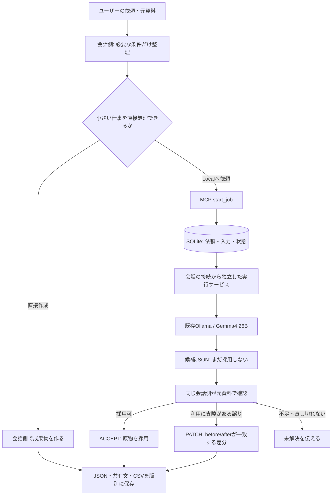

# Orchestrator Localの構成

独立したCloud ReviewerやLuna/Terraへの引継ぎを追加しない。会話側のモデルは利用者がアプリで選んだモデルなので、プログラムがSolやeffortを固定するものではない。

`core.py`が入力制限・JSON/schema検証・差分・保存、`server.py`がMCPの8ツール、`service.py`が一重起動とジョブ実行、`worker.py`がOllama接続と中止を担当する。Local候補にshell・ファイル操作・tool実行権限は渡さない。

元依頼と入力は固定して保存する。同じrequest_keyと入力の再送は同じジョブを返す。候補と保存結果はhashで識別し、古いhashや一致しないbefore、重複・親子の差分、出力形式違反を採用しない。追加修正は新しいresult版へ保存する。

実行サービスはMCP stdio processの子として起動しない。Windowsのクライアントがstdioの子processを終了しても作業を継続できるように、別起動とする。OS再起動などで実行が中断した場合はINTERRUPTEDとし、自動再生成しない。ログイン自動起動は利用者が選んだ場合だけ登録する。

JSON/schemaやCSV列の検証は形式確認であり、業務上の正しさの判定は会話側に残る。会話側の最終確認も誤り得る。研究用100件の結果や、別に公開したRust開発用のRouter/Workerを、そのままこの業務アプリの保証とは扱わない。
