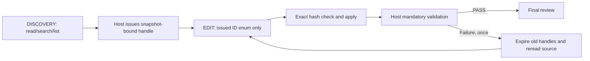

> Historical experiment report. Filesystem paths were removed; links to non-distributed original files are shown as source labels. [Task-to-result correspondence](../../sets/protocol-improvement-b3.md). This report alone does not establish a task result.

# Protocol Improvement Experiment B3 — 結果

2026-09-29 JST。**判定: PROMISING_FOR_V2_2。** 主指標のVALID_REGION_APPLY_RATEは、同じ3 TaskでB2の0/3からB3の**3/3**になった。実モデルによるread → issued handle → valid replace → mandatory validationを全Taskで確認した。

Local最終PASSとACCEPT_NO_CHANGEは**2/3**、FALSE_GREENは0件。一方、初回PASSは0/3で、1件はrepair後もformatがFAILした。Protocolの正常経路は改善したが、実装品質やformat対応の課題まで解決したとは扱わない。Routerへの反映・Pilot再開・candidateの本体採用は行っていない。

## 1. 目的

B2のregion-bound agentic経路だけを改善する。モデルに操作順序を記憶させる代わりに、Hostが状態と利用可能なcapabilityを所有する。

Task/source/acceptance/validationを維持し、stateful interfaceと内部識別子を除いたcontextを主な変更点とした。実行前固定commitは`cc3f1eb`、基準commitは`8944b79`。設計（元資料: README.md）、plan（元資料: plan.json）、freeze（元資料: freeze.json）に条件を保存した。

## 2. B2のregion failure

前回B2-003/004/005はすべてread/search前にreplace_regionへ未発行の自由文字列IDを送信し、INVALID_REGION_IDで停止した。source edit 0、validation到達0だった。

Hostは不正編集を防いだが、初回schemaにwrite操作が存在し、region_idが自由文字列だった。内部marker名もcontextに残っていた。B3ではこの選択肢をschemaから除いた。旧B2の結果・失敗履歴は保存したままである。

## 3. Stateful protocol設計

Hostの状態はDISCOVERY → EDIT → VALIDATION。正常終了または1回のrepairでTaskを終了する。phase遷移をモデルの宣言で決めない。

apply後は全有効handleを失効させる。repairではDISCOVERYに戻したうえで、直前の編集sourceをHostが再読してfresh handleを発行するBOUND REGION経路を使う。model routingやrepair回数は変更していない。

## 4. Discovery phase

公開する操作はread_file、search、list_directoryのみ。replace_region/apply_patch等のwrite操作はschemaに存在しない。read_fileのpathも既存のread scope内のenumとした。

liveでは3 Taskともread_fileを1回実行して対象sourceに到達した。search/list_directoryのlive使用は0件。候補fileと編集可能なbodyは従来どおりHostが限定しており、repo全体からの無制限な探索を評価したものではない。

## 5. Handle発行

Hostはhandleごとにfile、内部region identity、source/body hash、境界identity、行範囲、current contentと必要な周辺contextを保持する。モデルには内部marker名を渡さず、`rh_<session nonce>_<sequence>`というopaque IDを返す。

初回read由来3個、repair時のHost再読由来3個、合計6個を発行した。各Taskで1個ずつ有効になった。全applyの直前snapshotとdiskを照合し、保存済みモデル出力から6回の編集をメモリ上で再構成して、candidate全sourceと最終diffの一致も検証した。監査（元資料: metrics/final-audit.json）

## 6. Edit phase

少なくとも1個の有効handleを発行した後だけ、replace_regionを公開する。引数はregion_idとreplacementのみ。path、old text、markerの再入力は受け付けない。

今回のEDIT schemaはreplace_regionだけを公開した。6回すべてで発行済みIDが選択され、6回ともexact applyが成功した。ID補完・symbol解決・nearest-text/fuzzy適用は使っていない。

## 7. Dynamic schema

generationごとにHostが現在のphaseと有効handle集合からschemaを再構築した。DISCOVERYはwriteなし、EDITは現在のID enumのみ。Ollamaへの完全なrequestとschemaを保存し、Host側でも出力をそのschemaに照合した。

各Taskの3 generationのenum sizeは **0 → 1 → 1**。最後の1個はrepair用の新IDで、旧IDを除外している。9出力すべてが送信schemaに適合した。初回contextのeditable_regions/internal namesとsource/diff内のHost marker行はモデル向け表示から除去した。raw証跡・candidate sourceは原本のまま保持した。

INVALID_REGION_ID=0は「モデルが賢くなった」という結果ではなく、Host interfaceによる制約の結果と解釈する。schema適合する出力では未発行IDを表現できず、schemaを無視した出力もHostが拒否する。

## 8. Task一覧

| B3 run | 対応するB2 run | 単一責務 | Protocol |
| --- | --- | --- | --- |
| B3-003 | B2-003 | HighLoad evidenceにCPU当たりload比率追加 | stateful agentic |
| B3-004 | B2-004 | anomaly-free audit summaryにprocess件数追加 | stateful agentic |
| B3-005 | B2-005 | reusable skill reasonに現在のevent target追加 | stateful agentic |

Task JSONの変更はtask_idのみ。goal/interface/acceptance/runner設定/validationは同一で、選択sourceの全bytesも同一。Coverage Matrixもtask_id以外は同一。追加Taskとfixed_slot controlは0件。入力比較（元資料: preflight/paired-verification.json）

## 9. Handle interaction metrics

| 指標 | B3-003 | B3-004 | B3-005 | 合計 |
| --- | ---: | ---: | ---: | ---: |
| discovery tool calls | 1 | 1 | 1 | 3 |
| source reads（Host repair再読を含む） | 2 | 2 | 2 | 6 |
| search calls | 0 | 0 | 0 | 0 |
| HANDLE_ISSUED | 2 | 2 | 2 | 6 |
| HANDLE_SELECTED | 2 | 2 | 2 | 6 |
| EDIT_APPLIED | 2 | 2 | 2 | 6 |
| phase transitions | 5 | 5 | 5 | 15 |
| edit tool exposure | 2 | 2 | 2 | 6 |
| replace calls | 2 | 2 | 2 | 6 |
| invalid handle attempts | 0 | 0 | 0 | 0 |
| stale handle attempts | 0 | 0 | 0 | 0 |

handle単位のconversionは6 → 6 → 6。Task単位では3 → 3 → 3。phase transition数はEDIT移行・VALIDATION移行に加えrepair開始時のDISCOVERY復帰を含む。最初のDISCOVERY初期化は遷移として数えない。interaction監査（元資料: metrics/interaction-audit.json）

## 10. Valid apply rate

**VALID_REGION_APPLY_RATE = 3/3 = 100%。** 分子は実モデルがread/search → issued handle → valid replaceへ到達したagentic Task数であり、apply回数6をTask数として数えていない。

全Taskで初回から有効なapplyに到達し、その後repairでもfresh handleを使えた。今回INFRA_ERRORは0のため、実行Taskと有効Protocol Taskの分母はいずれも3。B2のpaired 3 Taskでは0/3だった。

## 11. Local PASS

| run | 初回 | 1回のrepair後 | Local最終 | Worker秒 | input/output tokens |
| --- | --- | --- | --- | ---: | ---: |
| B3-003 | format FAIL | 全checks PASS | PASS | 70.156 | 5,330 / 521 |
| B3-004 | compile + format FAIL | format FAILが残存 | ESCALATE / VALIDATION_FAILURE | 56.187 | 8,371 / 430 |
| B3-005 | format FAIL | 全checks PASS | PASS | 50.813 | 4,743 / 341 |

**First PASS 0/3、Local final PASS 2/3。** B3-004の初回は存在しない`SystemState.process_count`を使いE0609が発生した。Workerは実際のcompiler feedbackから`state.processes.len()`へ修正したが、rustfmtの改行要求は直せず終了した。

9 generation calls、Ollama reported input 18,444 tokens、output 1,292 tokens。Worker時間合計177.156秒、cohort START〜ENDは180.188秒。設計・preflight・Codexレビュー・報告時間は含まない。B2は編集前に停止していたため、時間/token増加を同じ成果量の速度比較とは扱わない。

## 12. ACCEPT_NO_CHANGE

**2/3（66.7%）**。B3-003は既存trigger/identity/evidence prefix/orderを保って比率のみ追加し、B3-005は現在のevent targetだけをreasonへ追加した。両候補は追加のworkspace regressionもPASSし、検証前後でsource bytesが不変だった。

B3-004はREJECT。最終機能テストとclippyはPASSしたが、明示されたAC-FORMATを満たしていない。MINOR_FIX分類には実際のCodex修正とLOC保存が必要という既存rubricを維持し、未修正candidateを受理扱いにしていない。

Codex通常repair介入0、candidate手動修正0件・0 LOC。本体採用0。未達成Taskがあるため、0 LOCを削減量とは解釈しない。Codexの正確なtokens/review時間は取得不能のためnull。レビュー入力はspec、coverage、discovery summary、selected handle、diff、validation、短いHost集計のWorker summaryであり、Local会話全文は読んでいない。モデルはtool JSONを返すprotocolのため、別の自由文summaryは生成させていない。レビュー（元資料: reviews/）

## 13. FALSE_GREEN

**0件。Local PASSを分母にすると0/2。** 定義は「Local PASS + 全configured checks PASS + 明示契約違反で最終REJECT」。B3-004はLocalがESCALATEのためFALSE_GREENには含めない。

小標本であり、coverage mappingだけでsemanticな網羅性を保証したとは扱わない。

## 14. Validation

B2のCoverage Gate実装はbyte-identicalのまま参照し、Host mandatory checks関数とreadiness関数はAST一致を検証した。23/23受入条件の対応表を維持した。

順序はacceptance-specific → targeted regression → format → clippy。source/Git guardは従来どおり各check前後に実行した。3 Task × 2 cycleの**全6 validation cycle**で必須checkを省略せず、guardを含む合計46結果を保存した。初回compile failure時にも残りのchecksを実行し、成功したふりはしていない。

モデルによるcheck選択・任意argv・shellは0、TEST_NOT_ALLOWEDは0。coverage不足なら全API call前にTASK_DESIGN_FAILURE / VALIDATION_COVERAGE_INCOMPLETEとするオフラインcanaryもPASSした。完全一致するB2 source/checkのred/golden/mutation証跡を再利用し、意味検証を新規実行したとは記録していない。

## 15. Repair

自然に発生した失敗だけで3件のrepairを実測した。**repair recovery 2/3**。人工的なlive失敗は0。初回failure分類はVALIDATION_FAILURE 2件、CODE_FAILURE 1件。最終failureはVALIDATION_FAILURE 1件だった。

Hostはfailed criterion/check・実stdout/stderr・candidate diff・fresh source/handleを同じモデルへ返した。会話履歴を維持し、旧handleを失効させた。Codexがretry promptを作ったりdiagnosticを修正したりしていない。最大1回を守り、B3-004への追加repair/retryは行っていない。

## 16. Scope/security

オフラインで新しい境界テスト11件、B2回帰10件がPASSした。discovery中write非公開、任意IDのenum拒否、expired handle、changed disk、cross-file引数/別session handle、marker/internal name、unknown capability、複数handleの選択を確認した。

既存Python 77件とRust fmt/clippy/test/check/buildもPASS。全6 live appliesについて境界・source/body hash・最終source/diff一致を監査し、scope guard regressionはなかった。117固定入力と旧6,060 tracked filesのSHA256が不変だった。

NO_HANDLE_DISCOVERED / INVALID_REGION_ID / STALE_EDIT_REGION / DISCOVERY_EXHAUSTED / EDIT_SCHEMA_ERROR / SCOPE_VIOLATION_MODEL / HOST_SCOPE_ERRORはliveで各0件。unsafe/fuzzy applyも0件。ただし、未知の全入力に対する安全性証明やOS sandboxを提供したものではない。

## 17. Infrastructure

モデルは`gemma4:26b`のみ。digest `08ae7ec1744bd7f451c4a530afb39d2673ad9d07a8369b8a33a3613b41212a68`、Ollama 0.34.4、RTX 3080 10GB、driver 591.86を維持。

baseline・各Task前後・finalの8 snapshotで既存health guard異常0。**INFRA_ERROR 0、CUDA 0、GPU query timeout 0**。snapshot時GPU使用量は1,599〜9,799 MiBであり、実行中peakや長期安定率ではない。Ollama報告residencyとnvidia-smiは別々に原本保存し、全GPU使用量をモデル固有VRAMと同一視していない。

Gemma12 inference、fallback、generation probe、強制unload、restart、download、driver/runtime/version変更は0。Operational Policy・model registry/routingは変更していない。health集計（元資料: metrics/health-summary.json）

## 18. B2とのpaired comparison

| Business Task | B2 | B3有効apply | B3最終レビュー |
| --- | --- | --- | --- |
| HighLoad CPU ratio | INVALID_REGION_ID、edit 0 | 初回・repairとも成功 | ACCEPT_NO_CHANGE |
| audit process count | INVALID_REGION_ID、edit 0 | 初回・repairとも成功 | REJECT: format未達 |
| skill event target | INVALID_REGION_ID、edit 0 | 初回・repairとも成功 | ACCEPT_NO_CHANGE |

同じ3 Taskのvalid applyは0/3 → 3/3、ACCEPT_NO_CHANGEは0/3 → 2/3。B2全体の2/5やfixed_slotの2/2をagenticの分母へ混ぜない。

業務条件・source・validation・generation optionsは同一。requestはdynamic schema、context除去、opaque handle、phase情報、実験Task IDが変わるためbyte-identicalではない。stateful interface一式の比較であり、enum制約だけの単独効果や一般的なモデル能力向上を証明した実験ではない。

## 19. v2.2採用可否

**PROMISING_FOR_V2_2。** 複数Taskでlive valid region applyを確認し、INVALID_REGION_ID=0、unsafe/fuzzy apply=0、TEST_NOT_ALLOWED=0、FALSE_GREEN=0、scope guard regressionなしという最低条件を満たした。

ただし小さな3 Taskであり、liveではread_fileと単一handleだけを使用した。search/multiple handles/cross-file負例はオフライン確認に留まる。今回のEDIT phaseは追加readを公開しないため、handle発行を「実装に必要な型情報も十分」と同一視しないことが今後の設計課題になる。B3-004の初回field誤りとの因果は断定できない。

次の独立変更候補は、stateful capability/issued-ID enum/repair時失効を維持したうえで、必要なread-only参照をどこまでEDITでも提供するか、format診断を含む複数失敗を1回で修正できるかを検証すること。今回のharness・条件を後付け変更せず、Router採用もまだ行っていない。採用判定（元資料: metrics/adoption-decision.json）

## 20. 結論

B2で未確認だった実モデルのread → handle → apply → validation → review経路を全3 Taskで確認できた。修正loopもWorker内で完結し、2件が修正不要の候補になった。一方、全件がrepairを必要とし、1件はformat未達で終了した。

結論は「stateful region interactionは次段階の採用候補」。Router/モデル能力の再設計や、Local Worker全体の品質・コスト削減の確定評価には広げない。

成果物: run history（元資料: run-history.json）、Task specs（元資料: tasks/）、Coverage（元資料: coverage/）、raw results（元資料: results/）、diffs（元資料: diffs/）、reviews（元資料: reviews/）、Task metrics（元資料: metrics/task-metrics.json）、CSV（元資料: metrics/task-metrics.csv）、request/response index（元資料: metrics/request-index.json）、summary（元資料: metrics/summary.json）、final audit（元資料: metrics/final-audit.json）。
