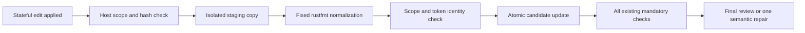

> Historical experiment report. Filesystem paths were removed; links to non-distributed original files are shown as source labels. [Task-to-result correspondence](../../sets/protocol-improvement-b4.md). This report alone does not establish a task result.

# Protocol Improvement Experiment B4 — 結果

2026-09-29 JST。**判定: PROMISING_FOR_V2_2。** Host formattingによってformat-only LLM repairを**2件回避**し、同じ3 TaskのLocal最終PASS・ACCEPT_NO_CHANGEはB3の2/3から**3/3**になった。必要なLLM repairはcompile errorに対する1回だけだった。

Host formatterのscope violation/error、FALSE_GREEN、TEST_NOT_ALLOWED、INFRA_ERROR、CUDAはすべて0。stateful valid region applyは3/3を維持した。これは**モデル＋Host normalization**の結果であり、モデルがformatまで正しく生成したという評価ではない。Router v2.2への反映、本体source採用、Pilot再開は行っていない。

## 1. 目的

rustfmtで決定的に解決できるformat調整をHostへ移し、LLMの1回のrepair予算をcompile/semantic/acceptance failureに使う効果を独立して検証した。

主変数はHost-owned deterministic formatting。B3のstateful capability、issued handle enum、snapshot/hash、Coverage Gate、mandatory validation、Task business requirements、Gemma26/options、最大1回のrepairを維持した。

実行前固定commitは`19487e0`、基準はB3結果commit `c168405`。設計（元資料: README.md）、plan（元資料: plan.json）、freeze（元資料: freeze.json）に条件を保存した。

## 2. B3結果

B3の同じ3 TaskはVALID_REGION_APPLY_RATE 3/3、INVALID_REGION_ID 0、Local final PASS・ACCEPT_NO_CHANGE 2/3、repair recovery 2/3だった。全3 Taskがrepairを必要とした。

B3-004は初回のcompile errorをrepairで解消したが、formatだけが残ってREJECTされた。今回、この保存済み最終candidateをB4内に再構成し、**追加inference 0・model repair 0**でHost formatterだけを適用したところ、全mandatory checksがPASSした。Host変更は5 LOCで、旧B3結果はESCALATEのまま保持した。別コピーの検査結果（元資料: replays/B3-004-saved-candidate/result.json）

## 3. Host formatting設計

新しいlive runでは次の順序にした。

formatterはHost内部operationで、モデルへtoolとして公開していない。pathはTaskのallowed filesからHostが決め、任意argvやshell指定を受け取らない。

既存rustfmt **1.9.0-stable (48a229ceae 2026-09-01)**、edition 2021、`skip_children=true`を使用した。binary SHA256とversionを各normalizationで確認し、固定configを利用した。toolchain/依存のinstallやversion変更はない。固定policy（元資料: formatter-policy.json）

## 4. Safety boundary

candidate本体をformatterへ直接書き換えさせず、B4内のstaging copyで処理した。出力全体を以下で確認してから、既存FileScopeによってcandidateへatomic applyした。

- file集合が不変で、変更fileがHost指定対象内。
- 許可された編集body以外のbytesが不変、既存diff LOC上限内。
- Rustの文字列・raw string・char・comment・identifier・number・operator等の保守的token fingerprintが一致。
- normalization後のrustfmt checkがPASS。
- 実candidateのsource/Git identityが処理中に変わっていない。

scope/token違反はFORMAT_SCOPE_VIOLATION、formatter自体の失敗はHOST_FORMAT_ERRORとしてcohort停止。検証できない出力を採用せず、モデルのcoding failureと区別する。

Fingerprintは完全なRust parserやsemantic proofではない。今回許可したのは検証できるwhitespace中心の変換であり、punctuation追加・comment書換えなどは、rustfmt由来でも拒否する制限を設けた。幅広いRust構文への一般化は別途検証が必要。

## 5. Task一覧

| 新run | B3対応 | 単一責務 | 変更した実験条件 |
| --- | --- | --- | --- |
| B4-003 | B3-003 | HighLoad evidenceにCPU当たりload比率 | Host formatting追加 |
| B4-004 | B3-004 | anomaly-free audit summaryにprocess件数 | 同上 |
| B4-005 | B3-005 | reusable skill reasonに現在event target | 同上 |

Task JSONの変更はtask_idだけ。goal/interface/acceptance/validation/runner設定を維持し、sourceもbyte-identical。Coverage Matrixもtask_id以外は同一。追加Taskとfixed_slot controlは0。入力検証（元資料: preflight/paired-verification.json）

EDIT phaseのread accessは変更していない。model向け説明、schema/handle実装、Coverage Gate、health guardもB3と同じ実装を使用した。

## 6. Model diff / formatter diff

各attemptについて以下を保存した。

| 差分 | 起点 → 終点 |
| --- | --- |
| model_generated_diff | 前回normalized candidate → 今回モデル編集直後 |
| host_format_diff | モデル編集直後 → Host formatting後 |
| final_candidate_diff | Taskの元source → 最終candidate |

| run | モデルedit回数 | normalization回数 | Host変更LOC |
| --- | ---: | ---: | ---: |
| B4-003 | 1 | 1 | 4 |
| B4-004 | 2 | 2 | 10（5＋5） |
| B4-005 | 1 | 1 | 5 |
| 合計 | **4** | **4** | **19** |

LOCは各attemptのadded＋removed。B4-004ではrepairが再び1行のformat式を返したため、再度正規化した。これらは累積処理量であり、最終diffのLOCと単純に加算する値ではない。Hostの19 LOCをモデル生成やCodex手動修正へ算入していない。各差分への索引（元資料: metrics/format-task-metrics.json）

## 7. FORMAT_RECOVERY_BY_HOST

**3/3 Taskでtrue。** 定義は「モデルcandidateがformat不適合 → Hostで正規化 → その他を含む全mandatory validation PASS」。attempt単位では4回中3回だった。

| run / attempt | pre-format | Host後format | その他checks | FORMAT_RECOVERY_BY_HOST |
| --- | --- | --- | --- | --- |
| B4-003 / 1 | FAIL | PASS | PASS | true |
| B4-004 / 1 | FAIL | PASS | compile FAIL | false |
| B4-004 / 2 | FAIL | PASS | PASS | true |
| B4-005 / 1 | FAIL | PASS | PASS | true |

pre-format stateはread-only rustfmt checkの実測。semantic checksはnormalization後に実施したため、前段はNOT_RUNと明示している。Hostがcompile errorまで直したとは扱わない。

## 8. Local PASS

| run | 初回（Host normalization込み） | repair | Local最終 | Worker秒 | input/output tokens |
| --- | --- | --- | --- | ---: | ---: |
| B4-003 | PASS | 不要 | PASS | 55.453 | 1,826 / 274 |
| B4-004 | compile FAIL | 1回でPASS | PASS | 55.843 | 7,949 / 430 |
| B4-005 | PASS | 不要 | PASS | 35.703 | 1,686 / 181 |

**First PASS 2/3、Local final PASS 3/3。** First PASSはHost normalization込みのWorker結果であり、raw model candidateのformat成功を意味しない。

B4-004の初回はB3同様、存在しない`SystemState.process_count`でE0609が発生した。Host formatting後もこのエラーは残り、同じモデルが実compiler feedbackから`state.processes.len()`へ修正した。その後、Hostがformatし全checksを通過した。

7 generation calls、Ollama reported input 11,461 tokens、output 885 tokens。Worker時間合計146.999秒、START〜ENDは150.069秒。設計・preflight・最終レビュー・報告時間は含まない。

## 9. ACCEPT_NO_CHANGE

**3/3（100%）、Host formattingあり。** 最終candidateはすべてCodex修正不要だった。B4-003は元のtrigger/identity/orderを維持、B4-004はno-anomaly reasonのみ変更、B4-005は現在event targetのreason追加のみで、固定authority/evidence/unsupported-intent処理を維持した。

3候補とも追加のworkspace regressionがPASSし、検証前後のsource bytesは不変だった。ACCEPT_WITH_MINOR_FIX、MAJOR_FIX、REJECT、最終escalationは0。

Codex手動repairは0件・0 LOC、通常repair loopへの介入0。本体採用0。レビューはTask Spec、Coverage Matrix、discovery/handle、3種diff、validation、短いHost集計Worker summaryから行い、Local会話全文は読んでいない。正確なCodex tokens/review時間はnull。レビュー（元資料: reviews/）

## 10. Repair回数

LLM repairは**1回**、B4-004のcompile errorに対してのみ実行した。repair recoveryは**1/1**。repair後もfresh source/handleを発行し、Host formatterを再実行した。formatのためのrepairや追加retryは行っていない。

Host normalization後も既存mandatory checksを同じargv・同じ順序で実行し、format checkも省略していない。4 validation cycleで、host scope guardを含む合計31結果を保存した。初回compile failureを隠さず、そのcycleの残りのchecksも実行した。

## 11. Repair回避

| run | 初回repair_needed_before_normalization | 初回repair_needed_after_normalization | 初回format-only repair回避 |
| --- | --- | --- | --- |
| B4-003 | true（format FAIL） | false | **1件** |
| B4-004 | true（format FAIL） | true（compile FAIL） | 0件 |
| B4-005 | true（format FAIL） | false | **1件** |

初回format-only repair回避は**2件**。B3のrepair 3回 → B4の1回となった。

B4-004のrepair後にもformat recoveryが1件あったが、これは「さらに許可していない2回目のrepairを節約した」とは数えない。B3でformat未達によって終了した箇所を、Hostだけで解消できた事象として別計数する。保存済みB3-004 candidateの5 LOC format-only検査も、live Task分母へ混ぜない。

beforeのsemantic状態は未実測だが、format FAILだけで旧方式ではrepair/終了が必要だったことと、許可scope・token identity・post checksで判断している。正確なCodex token削減量は推定していない。

## 12. FALSE_GREEN

**0件、Local PASSを分母にして0/3。** 「Local PASS＋全configured checks PASS＋明示契約違反で最終REJECT」という定義を維持した。formattingを導入しても最終レビューは省略していない。

Coverage Gateの23/23条件対応を維持し、対応表・test source/hash・mandatory validationの不変性を事前検証した。構造的なmappingが完全であることと、semantic coverageが完全であることは区別する。

## 13. Scope

**FORMAT_SCOPE_VIOLATION 0、HOST_FORMAT_ERROR 0。** モデルによるINVALID_REGION_ID、STALE_EDIT_REGION、scope failure、TEST_NOT_ALLOWEDも0。unsafe/fuzzy applyは0。

stateful VALID_REGION_APPLY_RATEは**3/3**。HANDLE_ISSUED → HANDLE_SELECTED → EDIT_APPLIEDは4 → 4 → 4、discovery readは3回、repairのHost再読を含めたsource readsは4回。EDIT phaseの追加read公開は行っていない。

オフライン安全性・回帰32件、既存Python 77件、Rust fmt/clippy/test/check/buildはPASS。範囲外file/region、新file、literal/token変更、formatter nonzero、post-check failure、format-only failureでのrepair非消費などを確認した。意図的な負例はliveのerror件数から除外している。

全4 editsについて、raw model replacement → pre-format source → Host差分 → normalized candidateをメモリ上で再構成し、各hash、各差分、実candidate、validation対象content IDの一致を確認した。133固定入力と旧6,364 tracked filesが不変だった。最終監査（元資料: metrics/final-audit.json）

## 14. Infrastructure

モデルは`gemma4:26b`のみ。digest `08ae7ec1744bd7f451c4a530afb39d2673ad9d07a8369b8a33a3613b41212a68`、Ollama 0.34.4、RTX 3080 10GB、driver 591.86を維持した。

**INFRA_ERROR 0、CUDA 0、GPU query timeout 0**。baseline・Task前後・finalの8 snapshotで既存health guardの異常は0。snapshot時GPU使用量は1,294〜9,710 MiBで、実行中peakや長期安定率の評価ではない。

Gemma12 inference、model fallback、generation probe、unload/restart、download、driver/runtime/version変更は行っていない。Router/Operational Policy/model routingは不変。health（元資料: metrics/health-summary.json）

## 15. B3 paired comparison

| 指標 | B3 | B4 |
| --- | ---: | ---: |
| VALID_REGION_APPLY_RATE | 3/3 | 3/3 |
| First PASS | 0/3 | **2/3（Host込み）** |
| Local final PASS | 2/3 | **3/3** |
| ACCEPT_NO_CHANGE | 2/3 | **3/3（Host込み）** |
| LLM repair | 3回 | **1回** |
| repair recovery | 2/3 | 1/1 |
| FALSE_GREEN | 0 | 0 |
| generation calls | 9 | 7 |
| input/output tokens | 18,444 / 1,292 | 11,461 / 885 |
| Worker秒合計 | 177.156 | 146.999 |

Task/source/acceptance/model/optionsは維持した。さらに、**今回比較した4つのformat前candidate fileは、対応するB3の同じattemptのモデルcandidateとbyte-identical**だった。したがって今回の改善を、モデルが偶然きれいなformatを生成した結果とは解釈しない。candidate比較（元資料: metrics/paired-model-candidates.json）

全request bytesはTask ID・opaque handle・repair context等が異なるため同一ではない。時間はcache/load/検証環境も含む単発観測で、汎用的な速度向上やCodex token削減率へは外挿しない。B3成功Taskのregressionは0件だった。

## 16. v2.2採用候補

**PROMISING_FOR_V2_2。** formatter scope violation/error 0、B3成功Taskのregression 0、format-only repairの安全な削減、FALSE_GREEN/TEST_NOT_ALLOWED 0、stateful valid apply維持という最低条件を満たした。

| 構成要素 | Recommendation |
| --- | --- |
| Coverage Gate | 維持。criterion/check/source bindingをdispatch前に検証。 |
| Host mandatory validation | 維持。format後も全checksと最終レビューを省略しない。 |
| Stateful capabilities | 維持。issued-ID enum・失効・fresh hash bindingを含める。 |
| Host formatting | 対応toolchainと言語・scopeを限定したnormalizationとして採用候補。 |

Host formattingはmodel output修正の一般権限ではなく、検証できるdeterministic normalizationに限定する。今回Router v2.2へ実装したり、Pilotを再開したりしていない。判定（元資料: metrics/adoption-decision.json）

## 17. 次の実験

EDIT phaseのread-only reference追加は別Experimentとして残す。B4-004では初回の型field誤りが再発したため、formatとは別に必要な型情報の供給を検証する価値がある。

Host formatterの追加検証候補は、複数file/region、macro・comment等を含む構文、format済みcandidate、構文不正時のHOST_FORMAT_ERRORと運用、staging/検証コスト。scopeを広げずfail closedを維持する。今回の3件だけで全Rust変更への安全性や効果を断定しない。

## 18. 結論

同じモデル生成candidateに対して、Hostがformatを所有することで2件の不要なLLM repairを回避し、B3-004のformatだけによる失敗も解消できた。compile errorは依然としてモデルrepairを必要とし、その区別を維持できた。

実験成果物はB4専用cohortに保存し、旧B3結果、Router、application、model registryは変更していない。

成果物: run history（元資料: run-history.json）、Task specs（元資料: tasks/）、Coverage（元資料: coverage/）、raw results（元資料: results/）、reviews（元資料: reviews/）、Task metrics（元資料: metrics/task-metrics.json）、format metrics / 3種diff索引（元資料: metrics/format-task-metrics.json）、request index（元資料: metrics/request-index.json）、summary（元資料: metrics/summary.json）、format summary（元資料: metrics/format-summary.json）、saved candidate replay（元資料: replays/B3-004-saved-candidate/result.json）。
