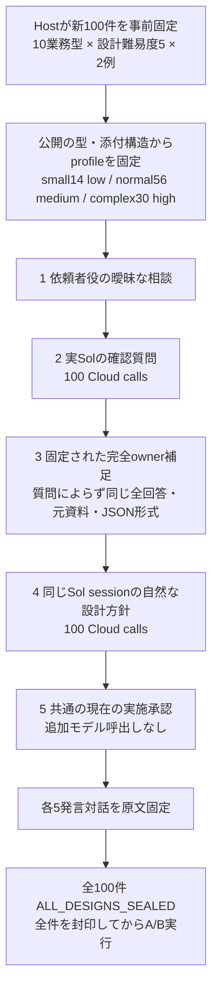
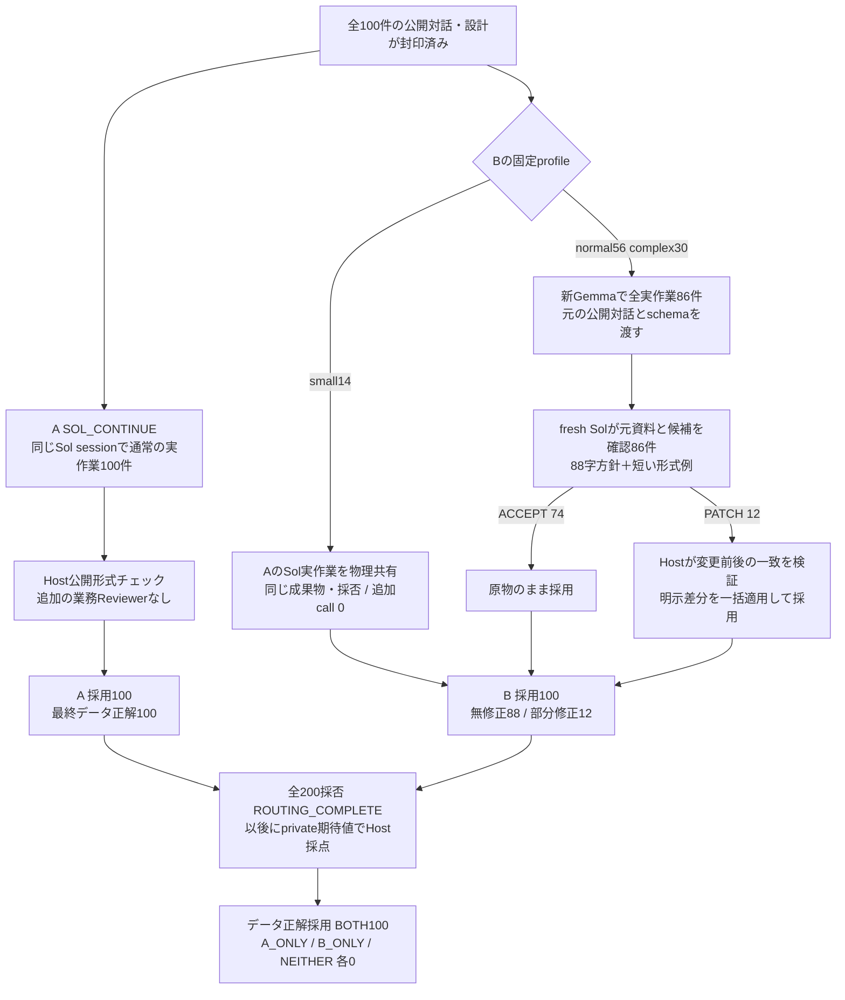
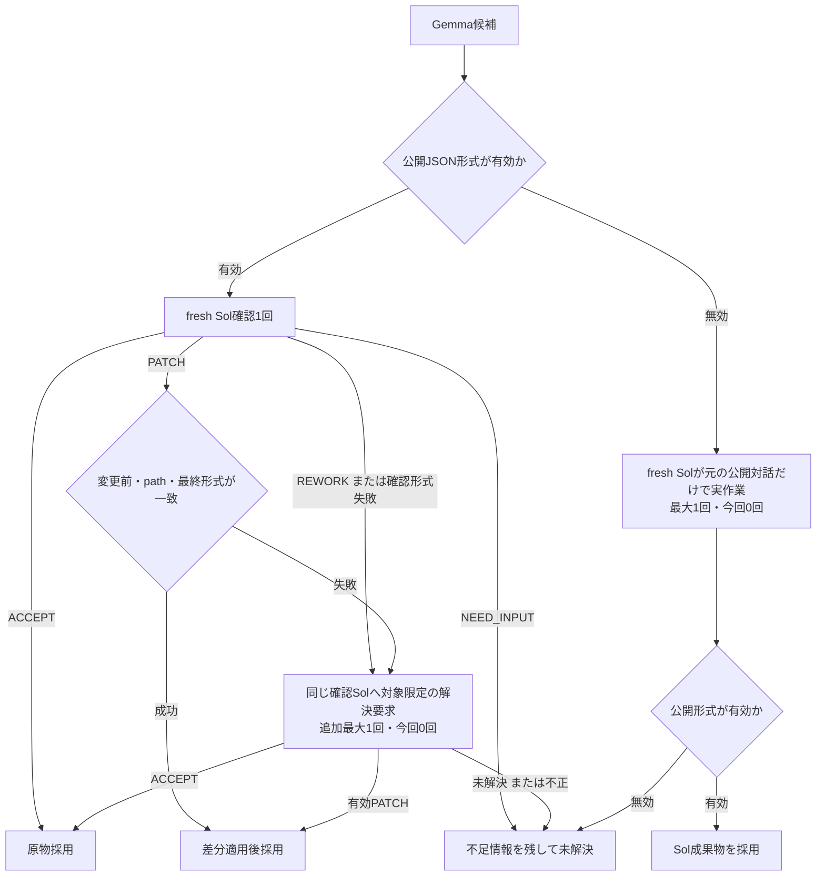
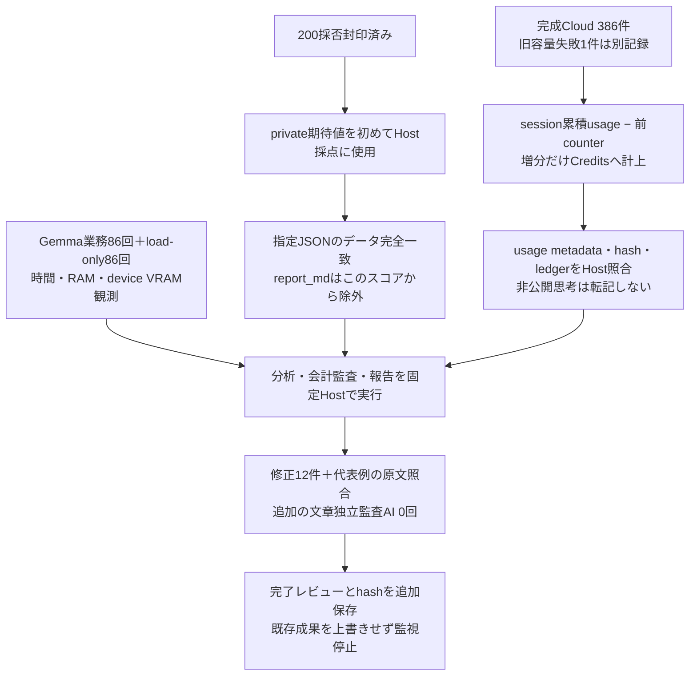

# 100件比較の詳細設計図

[結果の入口](README.md) / [説明資料](../../../docs/presentations/2026-11-practical-review-100.md)

対象は通常Sol（A）とPRACTICAL（B）の2方式。相談・設計から最終採用までを比較費用・active時間に含む。全件の独立した文章監査は追加していない。図中の実数は観測結果、例外経路は実装されたが今回未使用。

## 1. 入力と共通相談



相談役の初期条件・owner補足は合成したもの。実人間との自由な要件対話ではない。設計に元条件と異なる未合意の追加があれば元条件を優先。実施承認をA/B、worker、例外時のSolにも共通に渡す。

## 2. A/Bの実作業と採用



A/Bの先行順は課題ごとに回転する。smallでは同じ物理結果なので独立した2回の試験とは数えない。相談とsmall実行はunique支出へ1回、単独運用としての方式比較へそれぞれ全額配賦する。

実行settingsは [MODEL_SELECTION.json](MODEL_SELECTION.json)。Cloudはgpt-6.1-sol / Standard、low・medium・high。LocalはGemma4 26B、native thinking、ctx65536、output32768、seed20260926、temperature1 / top_p0.95 / top_k64、FA1 / KV f16。digestを固定。profile3段階と課題の設計難易度5段階は別の軸。

|profile|件数|Sol effort|Bの実作業|
|---|---:|---|---|
|small|14|low|Aの直接Solを共有|
|normal|56|medium|Gemma → fresh Sol確認|
|complex|30|high|Gemma → fresh Sol確認|

## 3. Sol確認契約と例外

実際の短い確認方針は次の88字。元資料・候補・短い出力形式例も別に渡すので、入力全体が88字という意味ではない。

> 依頼と元資料に照らし、使えるならACCEPTだけ返す。利用に支障のある誤りがあれば、箇所と影響を短く示し、直せるなら差分だけ返す。依頼にない要件・表現改善・採点表は追加しない。

```json
{"decision":"ACCEPT"}
```

```json
{"decision":"PATCH","changes":[{"path":"/totals/value","before":100,"after":200}],"impact":"誤った合計による判断を防ぐ"}
```

この数値例は契約説明用で、実測した特定課題の差分ではない。REWORKはdecision/scope/impact、NEED_INPUTはdecision/questionを返す。ACCEPTに任意改善を付けない。



PATCHはJSON Pointerで対象を指定し、before値を型も含めて厳密照合。重複path・親子が重なるpathを拒否し、変更は全件成功時だけ一括採用する。最終schemaと非空report_mdを確認する。Hostは意味やデータ値を勝手に補わない。PATCH後に再生成・別の意味確認はしない。

候補後Cloud最大2回。今回は最初の確認86回だけで全採否が決まり、追加RESOLVE・形式fallback・Gemma業務再生成は0回。Localインフラretryも0回だった。

## 4. 採点・会計・証跡



実装分担はrunner.py（source/A/B/採否）、policy.py（profile/確認/PATCH）、postprocess.py（採点/集計/会計監査/報告）。[source-snapshot](source-snapshot/) は当時のコードであり、環境一式の可搬実装ではない。

|記録|観測数|
|---|---:|
|完成Cloud：相談・設計|200|
|完成Cloud：A実作業|100|
|完成Cloud：B Sol確認|86|
|完成Cloud合計|386|
|旧容量失敗の記録|1|
|Gemma業務生成|86|
|独立の研究採点AI|0|

旧容量失敗のerror/turn.failed/INCOMPLETEは同じ物理1回を示す。内部再送の物理転送数・消費は完全には測れていない。記録上のCloud387＋Local86＝473と、load-only86操作は区別する。

## 5. 費用と時間の境界

|工程|報告usage Credits|単独A比較|単独B比較|unique study|
|---|---:|---|---|---|
|相談・設計200回|71.34362|全額1回|全額1回|1回|
|A実作業small14回|12.85060|全額1回|共有分全額1回|1回|
|A実作業その他86回|97.44906|全額|含まない|1回|
|B最終Sol確認86回|37.91074|含まない|全額|1回|
|独立の研究採点AI|0回|追加費用なし|追加費用なし|追加費用なし|

A181.64328、B122.10496、比較和303.74824。重複を除いたstudy既知小計219.55402。Local推論にCredits課金は計上しないが、tokensをCredits節約へ変換せず、電力・準備費はnull。

active時間は相談、load、生成、確認、差分処理、観測・停止を含む呼出しwall時間の合計。CPU実行時間ではない。他方式の待ち行列や一晩の停止/再開待ちは含めない。単独A6309.763秒、B24732.104秒。全studyの呼出しspan約28.61時間とは区別する。

RAM・VRAMはLocal観測。working set合計13.523 GiB、private22.726 GiB、device全体VRAM9769 MiB。共有ページや背景利用があり、最小必要量ではない。Cloud側のRAM/VRAMは測定していない。

## 6. この図で比較していないもの

初期相談をTerra/Lunaへ置換した方式、前回の三方式試験、全件の独立した文章同等性、実人間の要件対話、Office GUI、一般能力や本番非劣性は対象外。品質判断の原文確認と未計測費用は [完了レビュー](COMPLETION_REVIEW_JA.md) に記載する。
