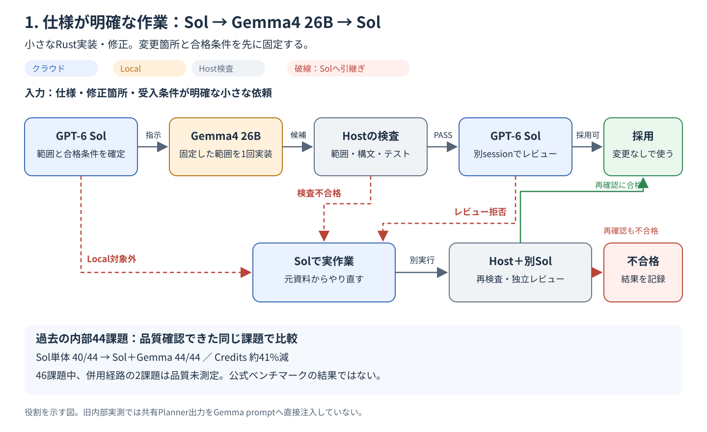
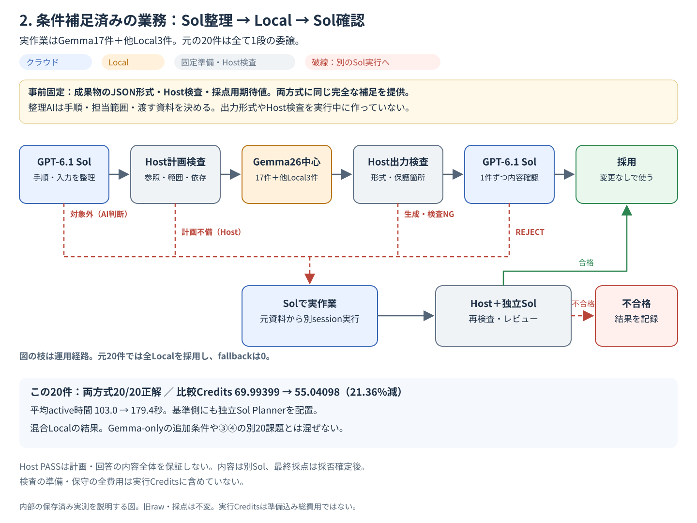
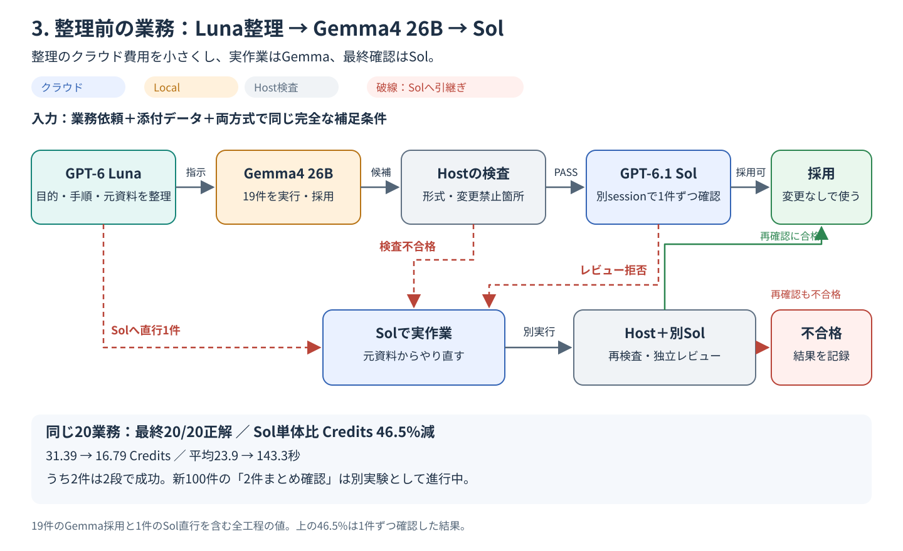
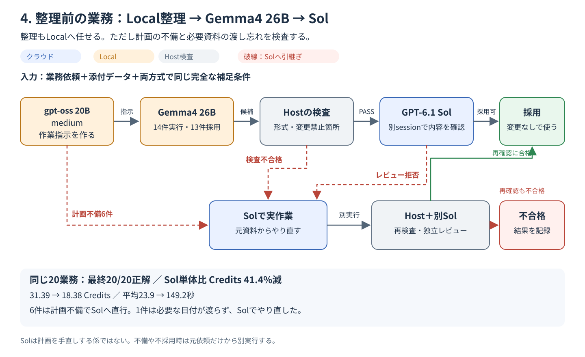

# SolとLocal LLMを組み合わせる4つの流れ

作成日：2026-10-29。目的は、**Solに任せた場合の品質を保ちながら、Codex Creditsを減らせるか**を分かりやすく示すこと。

4枚とも、青がクラウド、橙がLocal、灰色がHostによる機械的な検査。赤の破線はSolへの引き継ぎを示す。図は過去の実測を説明するもので、同じ課題・同じ条件による4方式の一斉比較ではない。

## 1. 仕様が明確な作業：Sol → Gemma4 26B → Sol

**渡す作業の範囲と合格条件を先に決められると、Gemmaへ任せる効果が出た。** 小さなRustの実装・修正で、編集場所、禁止範囲、テストを固定した構成。

- 同じ44課題では、Sol単体が40/44、Sol＋Gemmaが44/44でテスト・レビュー合格。
- 比較Creditsは約145.37 → 85.71、約41%減。
- 元の試行は46課題。併用経路の2件は品質確認まで到達していないため、この44件の数字を全46件の100%成功とは扱わない。
- ここは旧 **GPT-6 Sol** の内部Rust実験。公式30課題や、後述のGPT-6.1 Solの業務実験とは別。
- 図は役割の流れ。旧内部実測では、共有Plannerの計画全文をGemmaへ直接渡したわけではなく、固定した作業指示を使った。

出典：[既存の発表資料](2026-10-codex-local-llm-delegation.md#4-実測結果--小さな仕事では効果あり)、[全46課題の結果・未測定と会計の留保](../../benchmarks/internal-46/results/2026-10-22-astra-sol/RESULTS_JA.md)。

## 2. 整理前の業務：Solが整理 → Gemma中心のLocal → Sol

**業務を整理してLocalへ渡せたが、Solによる整理と確認の費用は残った。** 依頼と添付に、同じ完全な補足条件をそろえてから、目的、手順、入力資料、出力をSolが整理する。

|この実験の20業務|Solで整理・実作業・確認|Sol整理 → Local → Sol確認|
|---|---:|---:|
|最終正解|20/20|20/20|
|比較Credits|69.99399|55.04098|
|平均active時間/件|103.0秒|179.4秒|

- 比較Creditsは21.36%減。ただし、基準側にも独立したSol Plannerと確認工程を置いた実験。図3・4の「Solが1sessionで理解・実作業」とは基準が異なる。
- **Gemmaは17件、Qwen3.5は2件、gpt-oss20は1件。表は混合Local構成全体の成績であり、Gemmaだけの20件の成績ではない。**
- 実際のLocal計画は全件1段。「整理して一括で渡す」成功で、多段分解による改善はこの20件では測れていない。
- 共有の確認質問・回答がある。確認AIの費用は実支出では1回、比較では両方式へ全額を配賦した。同じ完全な補足回答を両方式へ渡しており、対話で不足情報を引き出す能力は未測定。

出典：手順未整理業務20件 `unstructured-business-20-20261028/revision002`。下記の[集計値と出典fingerprint](assets/2026-10-workflow-flows/evidence-summary.json)に保存済み集計との対応を記載。

## 3. 整理前の業務：Lunaが整理 → Gemma4 26B → Sol

**整理をLunaへ任せると、この20件ではSol品質を保ち、Creditsを大きく減らせた。** 実作業をGemmaに固定し、最終的な採否は別sessionのSolが決める。

|同じ20業務の比較|Solで理解・実作業 → Sol確認|Luna整理 → Gemma → Sol確認|
|---|---:|---:|
|最終正解|20/20|20/20|
|実行Credits|31.38868|16.7851495|
|平均active時間/件|23.9秒|143.3秒|

- Creditsは46.5%減。Gemmaで実行・採用した19件と、Solへ直接渡した1件を含む全工程の値。
- 19件のうち2件は「補充数量 → 予算内購入」「文章更新 → 参照監査」の2段で成功。前段の実出力を次へ渡した。
- ただし、2段に分けた効果だけを他の要素から切り離した試験ではない。多くは1段で済ませている。
- この完了済み20件は**1件ずつSolが確認**した。2件まとめ確認に変えた後の全工程の削減率ではない。

別の「同じGemma回答を使った確認だけの比較」では、Luna経由の19回答の確認費が16.76520 → 9.60190 Credits、42.7%減った。ただし19回答はすべて正解で、誤答見落とし率は測れていない。新100件の全工程比較は、この文書の作成時点で進行中。**46.5%と42.7%を足したり、そのまま掛けたりして新しい全工程削減率を作らない。**

出典：20業務3方式 `quality-cost-pilot-20261029`、回答固定の確認比較 `review-batch-comparison-20261029`。[集計値と出典fingerprint](assets/2026-10-workflow-flows/evidence-summary.json)。

## 4. 整理前の業務：Local LLMが整理 → Gemma4 26B → Sol

**整理自体のCodex費用はなくなったが、計画の不備や必要な資料の渡し忘れが残った。** ここで試したLocal Plannerは **gpt-oss 20B / medium**。Localモデル全般の結論ではない。

|図3と同じ20業務|Solで理解・実作業 → Sol確認|Local整理 → Gemma → Sol確認|
|---|---:|---:|
|最終正解|20/20|20/20|
|実行Credits|31.38868|18.38004|
|平均active時間/件|23.9秒|149.2秒|

- Creditsは41.4%減。計画不備6件は、Gemmaへ渡す前にSolへ直接引き継いだ。
- Gemmaで実作業した14件のうち13件を採用。残る1件は、Plannerが必要な`today`を渡し忘れ、期限超過一覧を誤った。Sol確認で止まり、元依頼からSolが解き直した。
- したがって、**SolがLocalの計画や答案を日常的に手直しする流れではない**。Solはまず採否を判断し、不適格・不採用なら別の実作業sessionで引き継ぐ。
- 不正な計画をHostが勝手に直したり、正解データを見てLocalを救済したりしていない。

出典：20業務3方式 `quality-cost-pilot-20261029`。[集計値と出典fingerprint](assets/2026-10-workflow-flows/evidence-summary.json)。

## 図を読む際の共通事項

- **Host検査とSol確認は別。** Rust実験のHostは構文・テスト・編集範囲を検査。業務DATA実験では主に出力形式と保護範囲を検査し、それだけで内容が正しいとは判定しない。
- **引き継ぎは答案の手直しとは別。** 原資料を使ってSolが新しく作業し、Gemmaの不採用答案・失敗診断は渡さない。図1・2の旧契約では有効な事前計画を含む場合がある。図3・4のclean Executorは元依頼・添付・同じ補足だけを受け取る。
- **整理と多段分解は別。** 出力名・入力資料・手順を決めるだけで1段にまとまる仕事もある。細かく分けること自体を成功基準にしない。
- **業務実験は小標本の合成机上DATA。** 実Office/PPT操作、未知の複雑業務全般、情報を対話で引き出す能力、公式30課題の達成を示していない。20/20の実測は受け入れつつ、一般的な品質非劣性は保証しない。
- **Creditsは保存済みnative CLI usage × 凍結した公式単価の集計。** アカウント残高の引落差ではない。失敗・引き継ぎは含むが、Localの電力・機器費、未測定の準備chat等を含む純利益ではない。Input内のcache、Output内のreasoningを二重加算しない。

SVGはそれぞれ個別にダウンロードし、PowerPoint等で拡大して使用できる。図の追加に伴う新しいモデル試行や採点変更は行っていない。
