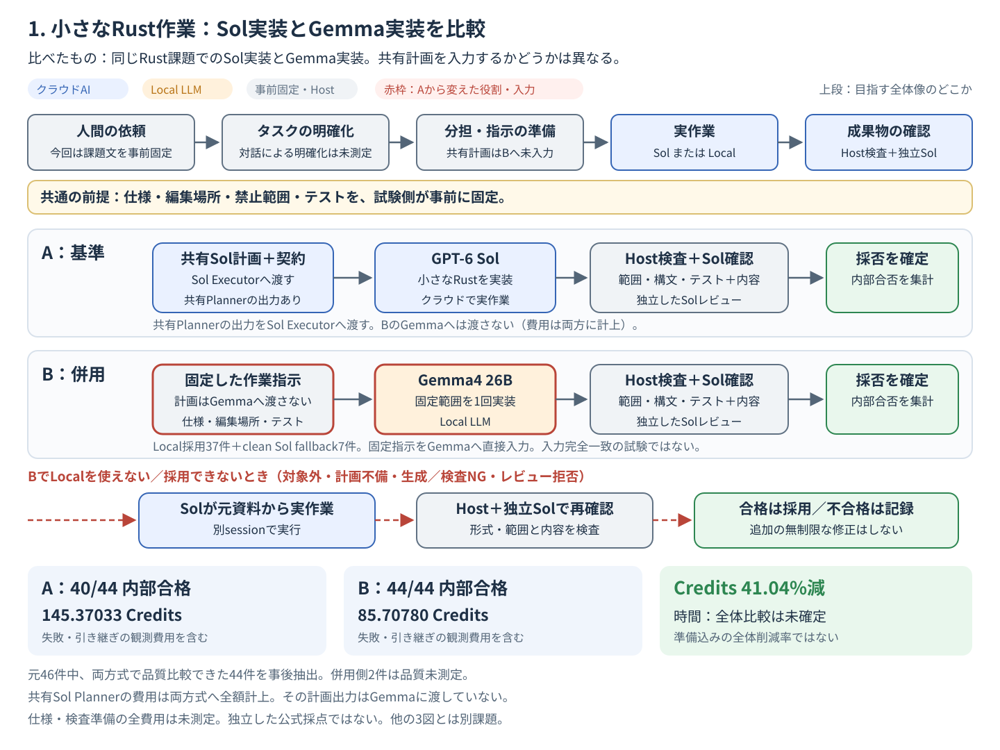
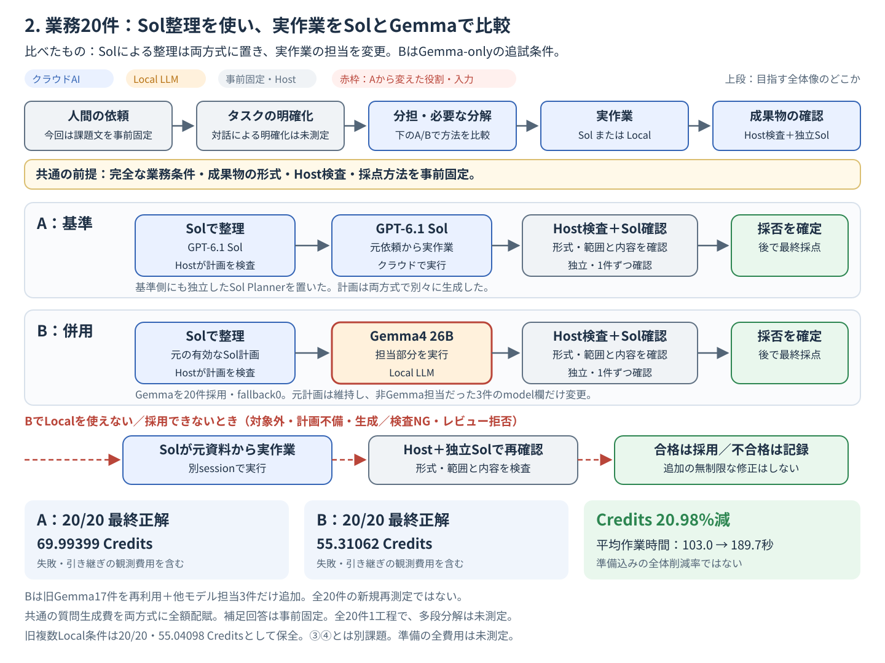
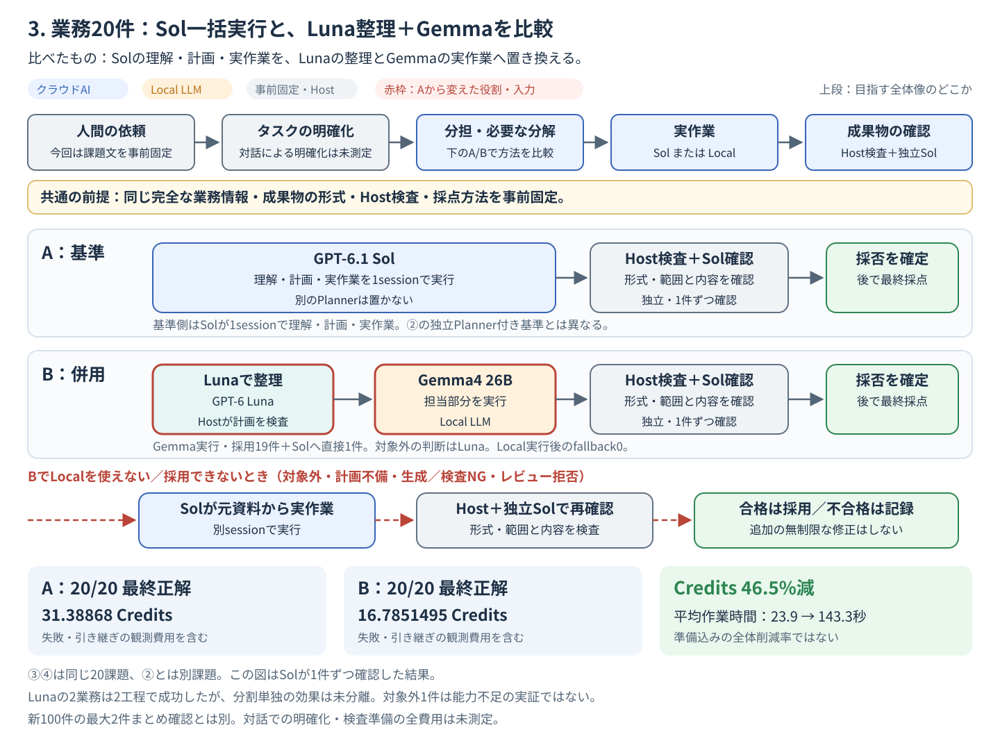
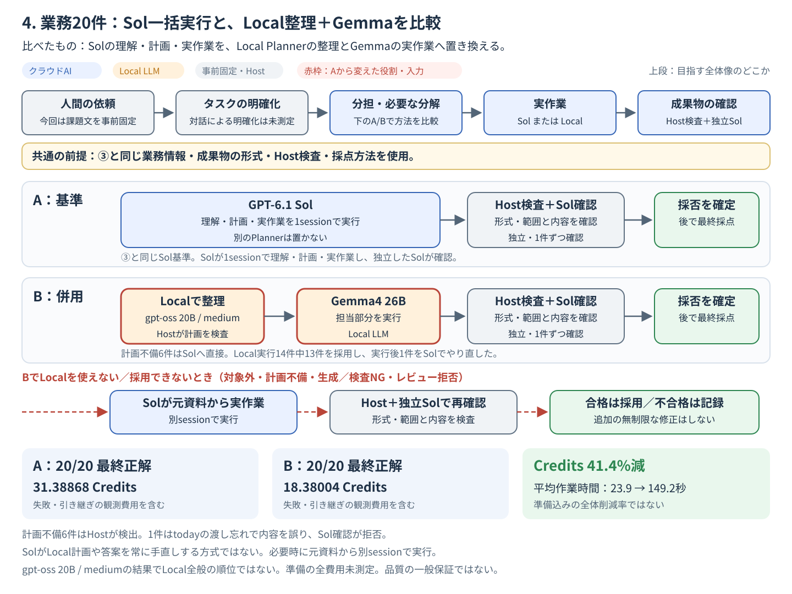

# SolとLocal LLMを組み合わせる4つの比較

2026-10-29更新。各図に**A＝比較基準、B＝Local併用**を並べ、置き換えた役割を赤枠で示した。上段には[目指す全体像と現在の実験範囲](2026-10-target-workflow-and-experiment-scope.md)も入れている。

|図|A：何と比べたか|B：何を試したか|課題の関係|
|---|---|---|---|
|①|固定契約＋共有Sol計画 → Sol実装 → Host・Sol確認|固定指示 → Gemma実装 → Host・Sol確認（計画は未入力）|内部Rust46件中、対応44件の事後的補助分析|
|②|Sol整理 → Sol実作業 → Host・Sol確認|元のSol計画 → Gemmaのみ → Host・Sol確認|同じ業務20件。Bは旧17件再利用＋3件追加の追試|
|③|Solが理解・計画・実作業を1session → Host・Sol確認|Luna整理 → Gemma → Host・Sol確認|新しい業務20件。②とは別|
|④|③と同じSol基準|gpt-oss 20Bで整理 → Gemma → Host・Sol確認|③と同じ20件|

**4方式を同じ課題で一斉に比べた試験ではない。** ②には基準側にも独立Sol Plannerがあり、③④の基準側は理解・計画・実作業を1sessionにまとめている。削減率の大小を、そのまま整理モデルの順位にしない。

> **共通の前提：必要な条件・出力形式・検査を、試験側が先に用意した。**
> 曖昧な依頼から人間に確認して条件をそろえる能力や、検査の準備・保守まで含めた全体の費用削減は未測定。
> 図の平均作業時間は、整理・モデル読込み・実作業・検査・確認・fallbackを含むactive時間。研究全体の待ち行列時間とは区別する。

[この構成のメリットと限界](2026-10-local-delegation-benefits-and-limits.md)。青はクラウド、橙はLocal、灰色は固定準備・Host検査。破線はLocalを使えない、または採用できない場合のSol実行。図はSVGで開いて保存・拡大できる。

## 1. 明確な作業指示 → Gemma4 26B → Sol確認

**この実測は、最初のSolによる指示作成が必要だと示したものではない。** 小さなRustの実装・修正で、仕様、編集場所、禁止範囲、テストを先に固定した。Gemmaは固定指示に従い1回実装し、Hostと独立Solが確認する。不採用なら別のSolが元資料から実装する。

入力の違いもある。共有Sol Plannerの出力は、AのSol Executorには契約のshared_planとして渡し、BのGemmaには渡していない。両方式へ同じ基礎課題を与えたworkflow比較であり、入力packetを完全に一致させて実装モデルだけを入れ替えた試験ではない。保存済みcontrollerのsetup/direct/local経路も確認した。

- 46課題を試行し、両経路で品質判定できた**対応44件を実行後に抽出した補助分析**では、Sol単体40/44、Sol＋Gemma44/44。併用側の内訳はLocal採用37件とclean fallback7件で、Gemma単独が44件解いたという意味ではない。
- この44件の比較Creditsは145.37033 → 85.70780、**41.04%減**。共有Plannerの費用を含む。先頭のSolを省いた構成の費用を測った値ではない。
- 元46件の併用側2件は品質未測定。44件だけの100%を、全46件完走や一般的な品質保証へ広げない。
- ここは旧 **GPT-6 Sol** の内部Rust実験。公式課題、GPT-6.1 Solの業務DATA実験とは別。時間は欠測があり、全件の速度優劣は未確定。
- **「Gemma直接＋Host＋Sol確認・fallback」と「Gemma直接＋Hostだけ」の比較は未実施。** Sol確認の必要性・費用対効果だけを切り離して証明していない。

出典：[同じ44件の説明](2026-10-codex-local-llm-delegation.md#4-実測結果--小さな仕事では効果あり)、[元46件の結果](../../benchmarks/internal-46/results/2026-10-22-astra-sol/RESULTS_JA.md)、[会計・時間の補足](../../benchmarks/internal-46/results/2026-10-22-astra-sol-addendum/FINAL_TECHNICAL_ADDENDUM_JA.md)。

## 2. 条件をそろえた業務20件：Sol整理 → Gemmaのみ → Sol確認

**Solによる整理を両方式に置き、実作業を誰に任せるかを比べた。** 元の混合Local条件はGemma17件＋Qwen3.5の2件＋gpt-oss20の1件だった。その後、非Gemma担当だった全3件へ同じ入力を与えてGemmaで追加実行し、Gemma-only条件を作った。

|同じ20業務の条件|最終正解|比較Credits|平均作業時間/件|
|---|---:|---:|---:|
|A：Sol整理 → Sol実作業 → Sol確認|20/20|69.99399|103.0秒|
|元の混合Local条件（旧結果を保全）|20/20|55.04098|179.4秒|
|B：元Sol計画 → Gemmaのみ → Sol確認|20/20|55.31062|189.7秒|

- 図のBはAに対し**20.98%減**。元の混合Local条件の21.36%減とは別の数値である。
- **Bは旧Gemma17件の生成・確認を再利用し、他モデル担当3件だけ追加した。** 全20件を新しく再測定したわけではない。新規呼出しはGemma3回＋Sol確認3回で、今回の追加Creditsは2.25010。55.31062は元の費用も含む比較額であり、今回の再課金額ではない。
- SolへGemma限定で計画を作り直させていない。元計画のmodel欄だけを変更し、workerへの入力・成果物形式は同じに保った。
- 全20件が1工程、Localを採用しfallback0。多段分解の効果や、新しいLocal失敗への耐性を証明した試験ではない。
- 確認質問の生成費は実支出1回、比較では両方式に全額配賦。同じ完全な補足回答を事前に渡したため、対話で不足情報を引き出す能力は未測定。
- ③④とは別の20課題。旧結果の再利用、cache・時刻・背景負荷の違いもあり、元の混合Localとの差をモデルの一般順位にしない。

出典：元 `unstructured-business-20-20261028/revision002` と追加 `sol-gemma-only-20-20261029` の凍結集計。[新しい比較図の集計・出典hash](assets/2026-10-workflow-comparisons/COMPARISON_EVIDENCE.json)。[旧・混合Local条件の詳細フロー図](assets/2026-10-workflow-flows/02-composite-sol-local-sol.svg)も保全している。

## 3. 条件をそろえた業務20件：Luna整理 → Gemma4 26B → Sol確認

**この20例では、実作業をGemmaへ任せ、整理をLunaへ任せた構成が、Sol基準と同じ最終正解数で少ないCreditsになった。** 検査準備まで含めた全業務一般の節約や、Sol品質の保証を示すものではない。

|同じ20業務の比較|Solが1sessionで理解・実作業 → Sol確認|Luna整理 → Gemma → Sol確認|
|---|---:|---:|
|最終正解|20/20|20/20|
|実行Credits|31.38868|16.7851495|
|平均active時間/件|23.9秒|143.3秒|

- Creditsは46.5%減。Gemma実行・採用19件とSolへ直接渡した1件を含む。19件でLocal失敗後のfallbackは発動していない。
- 19件のうち2件は「補充数量 → 予算内購入」「文章更新 → 参照監査」の2段で成功。前段の実出力を次へ渡した。ただし分割単独の効果を切り離した比較ではない。
- **③と④は同じ20課題。②とは別の20課題で、削減率の大小を整理モデルだけの効果としない。**
- この完了済み20件は**1件ずつSolが確認**した。2件まとめ確認とは別。

別の回答固定比較では、正しいGemma回答19件の確認費が16.76520 → 9.60190 Credits、42.7%減った。元19件に誤答がなく、見落とし率は未測定。**46.5%と42.7%を足したり掛けたりして全工程の削減率を作らない。** 新100件の全工程比較は別の実験であり、本書の過去20件の数値に含めない。

出典：`quality-cost-pilot-20261029`、`review-batch-comparison-20261029`。[集計と出典fingerprint](assets/2026-10-workflow-flows/evidence-summary.json)。

## 4. 条件をそろえた業務20件：Local整理 → Gemma4 26B → Sol確認

**整理のクラウドCreditsは0になったが、Local計画の不備を処理する費用・時間が残った。** Local Plannerは **gpt-oss 20B / medium**。Localモデル全般の結論ではない。

|③と同じ20業務|Solが1sessionで理解・実作業 → Sol確認|Local整理 → Gemma → Sol確認|
|---|---:|---:|
|最終正解|20/20|20/20|
|実行Credits|31.38868|18.38004|
|平均active時間/件|23.9秒|149.2秒|

- Creditsは41.4%減。計画不備6件は**固定Hostプログラム**が検出し、Gemma実行前にSolへ直接引き継いだ。
- Gemma実行14件中13件を採用。1件はPlannerが必要な`today`を渡し忘れ、期限超過一覧を誤った。旧Hostの計画検査では止まらず、Solレビューで拒否され、元依頼から別Solが解き直した。
- **Hostが有効とした計画でも、必要な情報が意味的に足りるとは限らない。** また、Solレビュー自体にも見落としの可能性はある。
- SolはLocal計画や不採用答案を常に手直しする係ではない。まず採否を判断し、不備・不採用なら別sessionで作業する。正解を見て経路を救済していない。

出典：`quality-cost-pilot-20261029`。[集計と出典fingerprint](assets/2026-10-workflow-flows/evidence-summary.json)。

## 誰が何を決めるのか

|段階|担当|確認・決定すること|できないこと・限界|
|---|---|---|---|
|準備|試験側が事前に実装・固定|成果物schema、Host検査、採点用の期待値|この準備を毎回自動生成する能力・費用は未測定|
|Local対象外|整理AI|計画内でCLOUD_ONLYを選択|適切な判断を常にできる保証はない|
|計画不備|Hostの固定プログラム|項目・担当範囲、存在しない参照、重複、工程の循環など|手順の意味や各工程への資料の十分性までは保証しない|
|Local出力の検査|Hostの固定プログラム|①はRustの範囲・構文・テスト、②〜④は主にJSON形式・保護箇所|任意の業務の正しさ全体は判定できない|
|内容の採否|独立Sol Reviewer|元依頼・元資料に照らして内容を確認|正解保証ではない。レビューは実作業の自動修正ではない|
|試験の最終採点|①はHost検証＋Reviewerの終端集計、②〜④は採否確定後の期待値照合|①の合格は内部検証の判定、②〜④は別の期待値との一致も確認|①を独立した公式採点と扱わない。業務DATAの期待値をActorやfallbackへ渡さない|

たとえば配置表なら、Hostは「必要な項目があるか、費用が数値か」を確認できるが、今回のDATA経路では最小費用の配置かを実行時Hostが再計算していない。内容をSolが確認し、その採否とは独立に最後の期待値照合で採点する。**整理AIがHost検査を自由に作り、自己採点している流れではない。**

## 数字の適用範囲と費用

- ②〜④は10業務型×2例の合成机上DATA。実Office/PPT操作や、完全に自由な依頼を受ける汎用業務システムの評価ではない。今回の成功例は受け入れつつ、一般的な品質非劣性や見落としゼロを保証しない。
- ①の編集・テスト環境、②〜④の出力形式・検査・期待値は先に用意した。**それらを作る準備chatの全Credits、保守・人間の工数は比較の実行Creditsに含めていない。** 初回の自由な仕事で同じ削減率になるとはいえない。
- 引き継ぎは元資料からの別実行。Localの不採用答案・診断・他arm回答は渡さない。①②の旧契約は有効な事前計画を含む場合があり、③④のclean Executorは元依頼・添付・同じ補足だけを使う。
- Creditsは保存済みnative CLI usage×測定時に凍結した公式単価。アカウント残高の実引落差ではない。失敗・引き継ぎの観測消費を含み、cacheはInput、reasoningはOutputの内数。Local tokensをCodex削減へ換算していない。
- 電力・機器費を含む総費用、準備込みの純利益、情報の完全なLocal保持、旧公式Actor Gateの達成を示したものではない。Sol確認には元資料を送るので、Localを使っただけで秘密情報がクラウドへ出なくなるわけではない。

SVGは個別に保存・拡大して使える。今回の訂正は文書・図だけで、旧モデル出力・採点・freeze・STOP・Productionを変更していない。

## 図の保存・旧図との関係

今回の4枚は、A/Bの違いを見せる比較図として追加した。以前の片側の詳細フロー図・集計・実験証跡は変更していない。②だけは監査済みのGemma-only追試を主図に反映し、元の混合Local条件も表に残した。

- [①の比較図](assets/2026-10-workflow-comparisons/01-fixed-rust-sol-vs-gemma.svg) ／ [旧・詳細図](assets/2026-10-workflow-flows/01-clear-spec-sol-gemma-sol.svg)
- [②の比較図](assets/2026-10-workflow-comparisons/02-sol-plan-sol-vs-gemma-only.svg) ／ [旧・混合Localの詳細図](assets/2026-10-workflow-flows/02-composite-sol-local-sol.svg)
- [③の比較図](assets/2026-10-workflow-comparisons/03-sol-direct-vs-luna-gemma.svg) ／ [旧・詳細図](assets/2026-10-workflow-flows/03-composite-luna-gemma-sol.svg)
- [④の比較図](assets/2026-10-workflow-comparisons/04-sol-direct-vs-local-gemma.svg) ／ [旧・詳細図](assets/2026-10-workflow-flows/04-composite-local-gemma-sol.svg)

全4枚とも1440×1080。数値は[比較図の集計・出典hash](assets/2026-10-workflow-comparisons/COMPARISON_EVIDENCE.json)と照合した。新しいモデル測定は行っていない。
