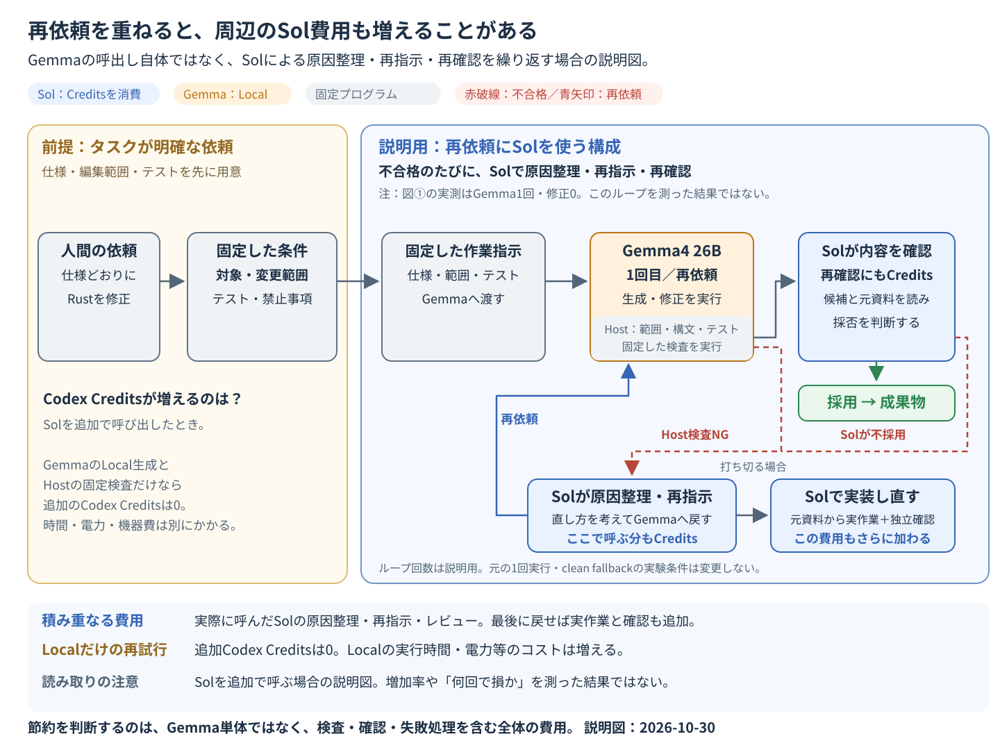

# Gemmaへ再依頼すると、Sol費用が増える場合

2026-10-30。図①「タスクが明確な依頼をGemmaへ任せる」の補足。

**これは、再依頼のたびにSolで原因整理・再指示・再確認を行う構成の説明図。再試行の増加率や損益分岐を測った新しい実験結果ではない。**

[SVGを開く・保存する](assets/2026-10-retry-cost/01-gemma-retry-overhead.svg)。既存の図と同じ1440×1080。

## 何の費用が増えるのか

Gemmaへの依頼回数だけで、Codex Creditsが増えるとはいえない。追加で誰を呼ぶかによって変わる。

|処理|追加のCodex Credits|そのほかの負担|
|---|---|---|
|GemmaをLocalで再生成する|この処理自体は0|Localの時間・電力・機器の使用|
|Hostの固定プログラムで検査する|この処理自体は0|Hostの実行時間・機器の使用|
|Solが失敗原因を整理し、修正指示を作る|実際に呼んだ分が追加|整理の待ち時間|
|Solが新しい候補を再レビューする|実際に呼んだ分が追加|確認の待ち時間|
|打ち切ってSolが元資料から実装する|実作業と確認に呼んだ分が追加|実作業・検査・確認の時間|

たとえば「Gemmaが失敗 → Solが原因を考えて再指示 → Gemmaが修正 → Solが再確認」を繰り返すと、原因整理とレビューのCreditsが積み重なる。最後にSolが実装し直せば、その費用も加わり、最初からSolが実装する場合より高くなることもある。

一方、Hostの診断をそのままGemmaへ返し、Solを呼ばずに再試行する構成なら、そのLocal再試行だけによる追加Codex Creditsは0。ただしLocalの時間や電力等まで無料という意味ではない。確認を省いても品質を維持できる、という結果でもない。

## 図①の結果との関係

- 図①の内部Rust実験は **Gemma1回・repair 0**。この補足図のように、失敗したGemmaへ何度も再生成を依頼した実測ではない。
- 元の図①では、Localが不採用なら元資料から別のSolが実装するclean fallbackを使用し、その観測費用を比較に含めている。
- 共有Planner等を含む図①の既存数値を、この再依頼ループの削減率・増加率として使わない。「2回目なら必ず割高」「回数に比例して同額ずつ増える」ともいえない。Solの入力・出力・キャッシュや、通った経路で消費が変わる。
- 図の矢印は制御プログラムが処理を切り替える流れ。Gemma自身が自律的にSolを呼ぶという意味ではない。
- 既存のone-shot、repair 0、STOPや会計証跡は変更せず、追加のモデル試験・再試行も行っていない。

**判断するのは「Gemmaが何回動いたか」ではなく、整理・検査・確認・失敗処理まで含めて、同じ品質を得るために使った全体のCredits。** Localの時間・メモリ・電力等は別に比較する。

出典と適用範囲：[発表資料の「Gemmaに修正をもう一度依頼する」](2026-10-codex-local-llm-delegation.md#試行②gemmaに修正をもう一度依頼する)、[図①の実測と比較条件](2026-10-four-delegation-workflows.md#1-明確な作業指示--gemma4-26b--sol確認)、[費用の考え方](2026-10-local-delegation-benefits-and-limits.md#費用の考え方)、[説明図の適用条件](assets/2026-10-retry-cost/ILLUSTRATION_SCOPE.json)。
