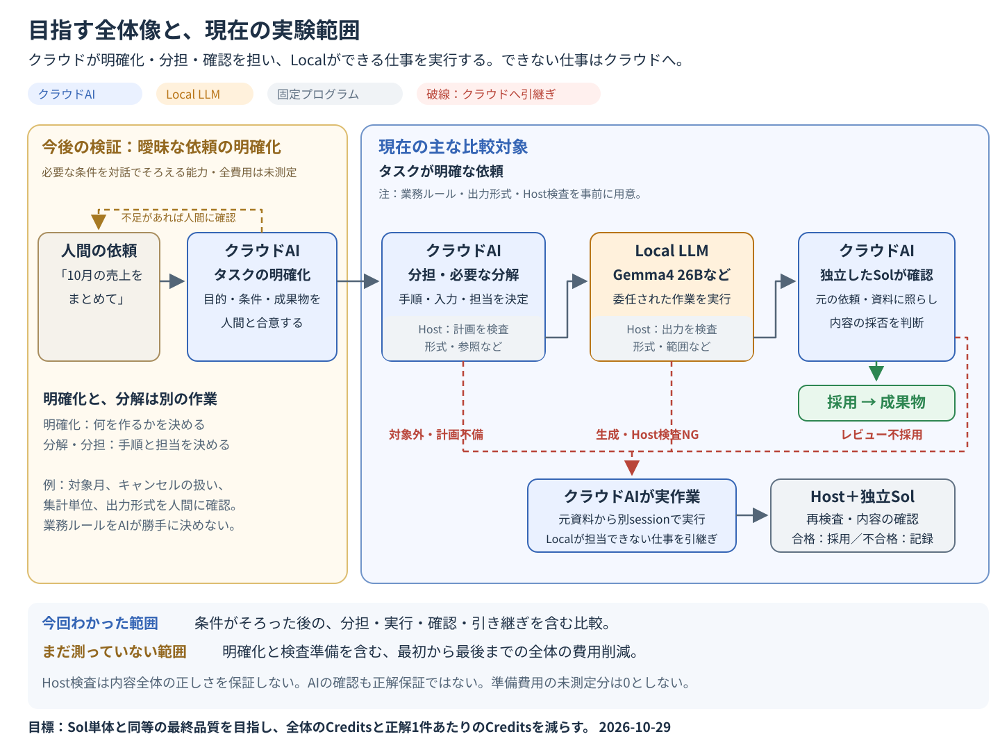

# 目指す姿と、現在の実験で確かめた範囲

2026-10-29整理。

**目標は、人間の曖昧さが残る依頼を受け、クラウドAIが内容を明確にして仕事を分担し、Local LLMができる部分を実行すること。最後はクラウドAIが確認し、Localが担当できない仕事はクラウドAIが行う。**

その全体で、Sol単体と同等の最終品質を目指しながら、Codex Creditsを減らしたい。Localに任せる割合を増やすこと自体は目的にしない。

## 全体像と、今回の実験の位置

[1枚図のSVGを開く・保存する](assets/2026-10-workflow-flows/00-target-workflow-and-scope.svg)。既存の4つのフロー図と同じ1440×1080サイズです。

編集用のMermaid図を表示

~~~mermaid
flowchart TD
    U["人間：曖昧さの残る業務依頼"] --> C["クラウドAI：目的・条件・成果物を明確化"]
    C -.->|"不足情報を人間に確認"| U
    C --> P

    subgraph TESTED["現在の主な比較対象：条件・出力形式・検査を事前に準備した範囲"]
        P["クラウドAI：手順・入力・担当を決める"]
        P --> G{"Host：計画の形式・参照を検査"}
        G -->|"Localへ渡せる計画"| L["Local LLM：委任された作業を実行"]
        P -->|"Localの対象外と判断"| F["クラウドAI：実作業"]
        G -->|"計画不備"| F
        L --> H{"Host：形式・範囲などを検査"}
        H -->|"合格"| R{"クラウドAI：内容を確認"}
        H -->|"不合格"| F
        R -->|"不採用"| F
        R -->|"採用"| O["成果物を採用"]
        F --> H2["Host検査＋独立したクラウドAIの確認"]
        H2 --> D{"採用できるか"}
        D -->|"はい"| O
        D -->|"いいえ"| S["不採用・停止を記録"]
    end

    classDef future fill:#fff4d6,stroke:#b7791f,color:#222;
    classDef cloud fill:#e8f1ff,stroke:#3b6eb5,color:#222;
    classDef local fill:#ffead6,stroke:#c46a16,color:#222;
    classDef host fill:#f1f3f5,stroke:#747b84,color:#222;
    class U,C future;
    class P,F,R cloud;
    class L local;
    class G,H,H2,D host;
~~~

**今回、比較した中心は「分担 → Local実行 → クラウド確認」。最初の明確化から最後までの一連の自動化・費用削減を実証したわけではない。** 図の採用は実行時の判断であり、正しさの保証ではない。業務DATA実験では、その判断を固定した後に別の期待値と照合して最終採点した。

## 何を実験し、何をまだ測っていないか

|段階|目指す役割|現在の実験の範囲|
|---|---|---|
|依頼の明確化|人間に確認し、目的・対象・業務ルール・成果物を確定する|完全な補足条件を試験側で事前に用意し、両方式へ同じ内容を提供。必要な情報を対話で引き出し、明確化する能力と全費用は未測定|
|タスクの分担・必要な分解|手順、渡す資料、担当モデル、工程間の受け渡しを決める|Sol・Luna・Local Plannerを使った比較を実施。Local Plannerはクラウド整理の代替候補として試した|
|委任作業の実行|Gemma4 26Bなどが担当部分を解く|条件と入力を与えて実行し、精度・時間・メモリを測定|
|成果物の確認|元の依頼・資料と照合して採否を決める|事前に用意したHost検査と、独立したSolレビューを実施。1件確認と最大2件まとめ確認も比較|
|クラウドへの引き継ぎ|Local対象外や失敗した仕事を担当する|対象外・計画不備の直接経路と、Local失敗後のfallbackを実施し、その費用も計上|

以前の一部の20件では確認質問の生成も試したが、質問に応じて回答を選んだのではなく、同じ完全な補足回答を両方式へ渡した。これを、曖昧な依頼から必要条件を聞き出せた証拠とはしない。

## 「明確化」と「分解」は違う

たとえば、人間の依頼が「10月の売上をまとめて」だった場合。

- **明確化**：対象の年・月、キャンセルの扱い、集計単位、未達の基準、出力形式を確認する。キャンセル除外などの業務ルールをAIが勝手に決めるわけではない。
- **分解・分担**：条件が決まってから、「対象データを抽出する → チーム別に集計する → 目標と照合して出力する」などの手順と、各工程の担当・入力・出力を決める。

今回の業務実験は、**必要な業務ルール・出力形式が事前指定された依頼**から始めた。「条件補足済みの業務」は、この意味で使っている。条件が4つあるから4回のLocal呼出しに分ける、という意味ではない。まとめて解けるなら1工程でよく、実際に1工程の計画が多かった。

## 検査を先に用意していた、という前提

今回の成果物の形式、Host検査プログラム、採点用の期待値は、試験側が事前に作って固定した。実行中の整理AIが検査コードを自由に作り、自己採点したわけではない。

Hostは計画の形式・入力参照や成果物の形式・保護範囲などを確認する。任意の業務の内容が正しいか、各工程に意味的に十分な資料があるかまでは保証しない。内容はSolが確認し、その確認にも見落としはあり得る。採点用の期待値は、採否やfallbackを決めるためには使っていない。

自由な依頼ごとに成果物や検査方法を決める工程と、その準備・保守の全費用は、まだ一連の比較に含められていない。これらを試験側が事前にそろえた分を、クラウドAIが無料で自動処理したとは扱わない。

## 過去の図・実験との対応

|資料・実験|全体像のどこを見たか|
|---|---|
|図①：仕様が明確な小さなRust作業|固定した作業指示 → Gemma → Host・Sol確認。別途計上した共有Sol Plannerの出力はGemmaに渡していない|
|図②〜④：業務20件の整理モデル比較|条件をそろえた後の整理・分担 → Local → Sol確認。課題集合や基準側が異なるので、4方式の一斉比較ではない|
|新100件：Sol単体対Luna整理 → Gemma → Sol最大2件確認|同じ完全な条件と検査枠組みの下で、直接実行・fallbackも含めた後半の品質・時間・Creditsを比較|

実験ごとの数値・条件は、[4つのフロー図](2026-10-four-delegation-workflows.md)と[メリット・限界](2026-10-local-delegation-benefits-and-limits.md)を参照。上の新100件は、過去20件の数値とは別の実験である。

## 最終目標の達成をどう判断するか

今後は、同じ曖昧な依頼から始めるSol単体と併用方式で、確認への回答・利用できる資料をそろえて比較する必要がある。

**明確化・分担・実作業・検査準備・レビュー・失敗時の引き継ぎまで含めて、最終品質を維持し、実行Creditsと正解1件あたりのCreditsを減らせたか**で判断する。時間・メモリ、人間の確認負担、電力・機器費も別に記録する。未計測の準備費用を0とはしない。

現在の削減率は、それぞれの実験で計測した範囲の結果として受け入れる。ただし、その率を「曖昧な依頼から完了まで全部を安くできた」という結果へ広げない。Office/PPTの実操作や、任意の業務での品質保証も未検証である。
