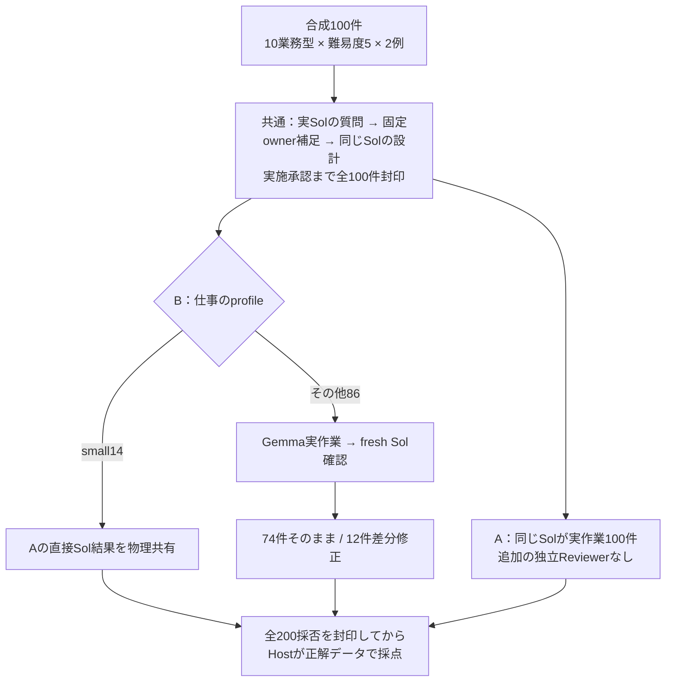

# 必要なところだけ直す：Sol＋Gemmaの100件比較

**Solが相談と設計を行い、実作業をGemmaへ渡し、最後にSolが使えるか確認する。使える候補はそのまま採用し、必要な誤りは差分だけ直す。** この運用を通常Solの続行と比較した。

2026年11月5日完了・11月7日公開。[全100件と根拠](../../benchmarks/practical-review-100/2026-11-05/README.md) / [詳細設計図](../../benchmarks/practical-review-100/2026-11-05/DETAILED_DESIGN_JA.md)

## 何を確かめたか

大筋が合う成果物を文体の好みで作り直すことを避け、作業内容・指定データ・利用に支障のある説明だけを確認する設計。軽い仕事にはSol lowを直接使い、通常はmedium、複雑な仕事はhighとして両方式を揃えた。

相談・設計、実作業、確認・差分採用までを費用とactive時間へ含む。Host採点に別AIは追加していない。small14件は独立したGemma試行ではない。

## 結果

|項目|通常Sol A|PRACTICAL B|
|---|---:|---:|
|採用データ正解|100/100|100/100|
|誤採用 / 未解決|0 / 0|0 / 0|
|無修正採用|100|88|
|差分修正後採用|0|12|
|運用の報告usage小計Credits|181.64328|122.10496|
|正解採用1件あたり既知小計|1.8164328|1.2210496|
|平均active秒、相談込み|63.10|247.32|

**Sol確認費込みの既知小計は59.53832 Credits少なく、平均active時間は約3.92倍。** 同じデータ採用結果で費用と待ち時間を交換した。32.78%減は報告usage小計の参考比率で、内部再送と容量失敗の消費が不明なので実支出総額・厳密な削減率は確定しない。

## 直した内容と、直さなくてもよかった余地

Gemma86件は初回76/86のデータが正解。10件の指定データを差分修正し、最終86/86へ揃った。12PATCHのうち2件は文章だけ。

|例|内容|読み方|
|---|---|---|
|[011](../../benchmarks/practical-review-100/2026-11-05/cases/PR100-011.json)、[051](../../benchmarks/practical-review-100/2026-11-05/cases/PR100-051.json)|優先順を誤り、予定終了と遅れを過小表示|後続明細まで必要な再計算|
|[019](../../benchmarks/practical-review-100/2026-11-05/cases/PR100-019.json)|数字は正しいが数量を件数と呼び、不足原因も在庫と説明|lot単位が原因の注文があり、説明訂正には意味がある|
|[038](../../benchmarks/practical-review-100/2026-11-05/cases/PR100-038.json)|元の数字・結論は正しい。期限ちょうどの注意を追記|明細併読の実務基準なら任意補足寄り。必須修正と断定しない|

12件とも、最初から予定したSol確認の返答の中で差分を返している。修正を受けてGemmaを再実行した回数も、追加のSol解決呼出しも0回。関連明細の再計算を含むので、すべてが一文字の修正だったわけではない。038を避けた場合の節約額は測っていない。

[全12件の索引と原文](../../benchmarks/practical-review-100/2026-11-05/PATCH_CASES_JA.md) / [完了時の解釈](../../benchmarks/practical-review-100/2026-11-05/COMPLETION_REVIEW_JA.md)

## 何が費用に入っているか

共通Sol相談・設計71.34362、small共通実作業12.85060、BのSol確認37.91074 Creditsを計上済み。Bの122.10496は「確認を後で足す前」の金額ではない。独立した研究監査AIは0回。

方式比較では共有工程を各方式へ1回ずつ全額配賦する。重複を除いたstudyの既知小計219.55402と、比較金額の和303.74824を混同しない。会話継続CLIの累積usageは前counterとの差分だけ計上した。Local tokensはCredits節約に換算しない。

## 適用範囲

100/100はJSONの指定データ正解採用。運用Solは文章も確認し、完了時に12修正と代表例を原文照合したが、全200文章の独立監査はしていない。「文章まで一般的にSol同等」と証明した結果ではない。

既知10型の合成課題、固定された完全owner回答、全相談を先に終える進め方に限定される。実人間の要件対話や実Office GUI、100独立能力、一般的な非劣性を測っていない。cache、時刻、背景負荷、停止・再開待ちの留保もある。過去のTerra/Lunaやxhigh試験と率を混ぜない。

この結果は、使える原物を残し必要な部分を直す運用が機能した例と読める。ただし細部への余計な介入が完全になくなったわけではなく、時間も長くなった。費用・待ち時間・利用上の品質を一緒に判断する。

[全件CSV・再検証手順](../../benchmarks/practical-review-100/2026-11-05/README.md) / [ほかの説明資料](README.md)
